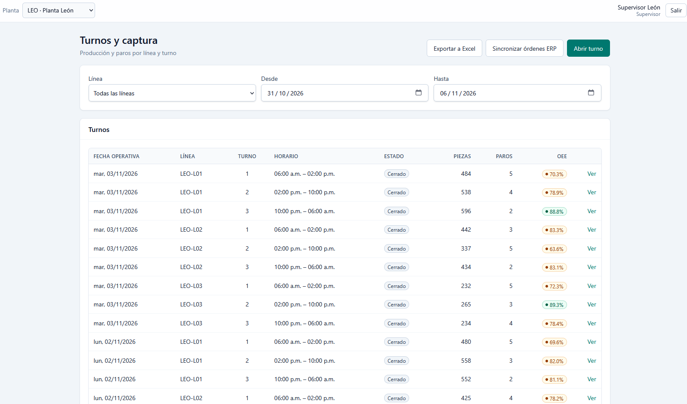
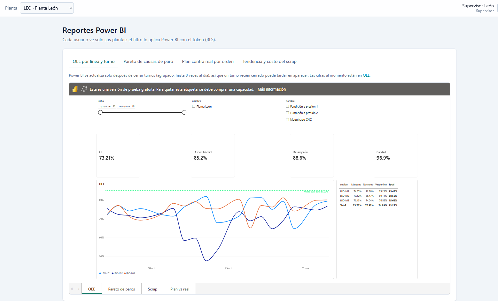
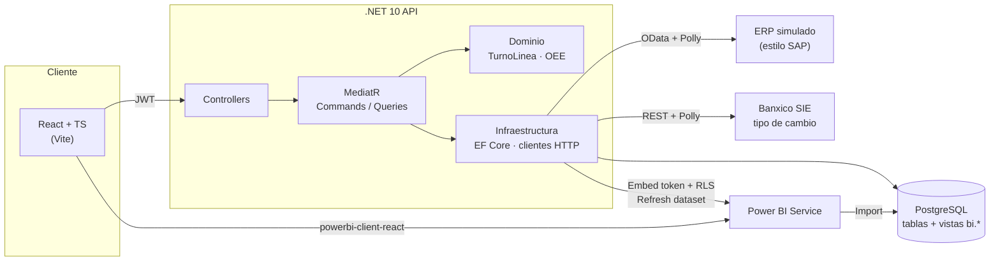

# PlantPulse · KPIs de producción con Power BI Embedded

[](https://github.com/hector8789/PlantPulse/actions/workflows/ci.yml)


Aplicación web empresarial para plantas de manufactura. El supervisor captura la **producción y los paros por línea y turno**; el sistema calcula **OEE, scrap y cumplimiento del plan**, trae las órdenes de un **ERP tipo SAP (OData)**, valúa el scrap en MXN y USD con el **tipo de cambio de Banxico** y muestra reportes de **Power BI embebidos con seguridad por planta (RLS)**.

> Proyecto de portafolio de [Hector Alvarado Venegas](https://github.com/hector8789) — Senior Full Stack Developer (.NET · React · SQL · SAP).





## Qué demuestra

| Área | Implementación |
|---|---|
| **Backend .NET** | API REST en .NET 10 con **Clean Architecture** (Domain / Application / Infrastructure / Api), **CQRS con MediatR**, validación con FluentValidation, EF Core + PostgreSQL, **JWT con roles** y acceso por planta, errores como **ProblemDetails** (400/401/403/404/409/422/503). |
| **Dominio rico** | El agregado `TurnoLinea` protege las reglas: ventana de captura de 7 días, paros sin traslape y dentro del turno, turno cerrado inmutable, evento de dominio `TurnoLineaCerrado`. [Reglas de negocio](docs/reglas-de-negocio.md). |
| **Power BI** | **Power BI Embedded (App Owns Data)**: el API se autentica como *service principal*, genera el **embed token con RLS** (`PorPlanta`) y lanza el **refresh del dataset** al cerrar un turno, agrupando peticiones para respetar los límites. Modelo en copo de nieve sobre vistas `bi.*` y medidas DAX. [Guía de Power BI](docs/power-bi.md). |
| **Integraciones** | Cliente **OData** para órdenes de producción de un ERP simulado (estilo SAP, con estados TECO) y cliente de la **API SIE de Banxico** (serie FIX SF43718). Ambos con **Polly** (reintentos exponenciales con *jitter*). |
| **Frontend** | React 19 + TypeScript + Vite, TanStack Query, Zustand, React Hook Form + Zod, Tailwind CSS. Captura de turnos y paros, dashboard de OEE, **exportación a Excel**, reportes embebidos con **renovación automática del token**. |
| **Calidad** | 150+ pruebas en xUnit (dominio, aplicación e integración con `WebApplicationFactory`) y 40 en Vitest + Testing Library. CI en GitHub Actions. |

## Arquitectura



```
api/
├── src/
│   ├── PlantPulse.Domain/          Entidades, value objects, reglas y cálculo de OEE
│   ├── PlantPulse.Application/     Comandos y consultas (MediatR), validadores, puertos
│   ├── PlantPulse.Infrastructure/  EF Core, migraciones, seed, ERP OData, Banxico, Power BI
│   └── PlantPulse.Api/             Controllers, JWT, CORS, ProblemDetails, ERP simulado
├── tests/                          Domain · Application · Api (integración)
└── PlantPulse.pbix                 Reporte de Power BI (4 páginas, rol RLS PorPlanta)
web/
└── src/features/                   auth · catalogos · produccion · paros · kpis · reportes
docs/                               Reglas de negocio · contrato API · guía de Power BI
```

## KPIs

- **OEE** = Disponibilidad × Desempeño × Calidad, por línea, turno y periodo. Al agregar, se suman tiempos y piezas y se recalcula (no se promedian porcentajes).
- **Pareto de causas de paro** (no planificados).
- **Scrap** en piezas y su costo en MXN y USD.
- **Plan contra real** por orden de producción.

Los resultados del API y de Power BI coinciden con los datos demo: **OEE total 74.64%** (León 73.21%, Silao 76.75%).

## Correrlo en local

### Opción A · Docker (todo en un comando)
```bash
docker compose up --build
```
- Web: http://localhost:5173
- Swagger: http://localhost:5077/swagger

La base se crea y se llena con datos demo (2 plantas, líneas, turnos, órdenes, producción y paros) al arrancar.

### Opción B · Desarrollo
Requisitos: .NET 10 SDK, Node 22 y PostgreSQL.

```powershell
cd api
dotnet tool restore
dotnet user-secrets set "ConnectionStrings:PlantPulse" "Host=localhost;Database=plantpulse;Username=postgres;Password=..." --project src/PlantPulse.Api
dotnet user-secrets set "Jwt:Key" "<llave de al menos 32 caracteres>" --project src/PlantPulse.Api
dotnet tool run dotnet-ef database update --project src/PlantPulse.Infrastructure --startup-project src/PlantPulse.Api
dotnet run --project src/PlantPulse.Api --launch-profile https
```
```powershell
cd web
copy .env.example .env.local      # VITE_API_URL=https://localhost:7177/api
npm install
npm run dev
```

**Opcionales:** `Banxico:Token` (tipo de cambio real) y `PowerBi:TenantId / ClientId / ClientSecret / WorkspaceId` (reportes embebidos). Sin ellos la app funciona y esos endpoints responden 503 con un mensaje claro.

### Usuarios demo
Contraseña de todos: `PlantPulse2026!`

| Usuario | Rol | Plantas |
|---|---|---|
| `admin@plantpulse.mx` | Admin (único que reabre turnos) | Todas |
| `supervisor.leon@plantpulse.mx` | Supervisor | León |
| `supervisor.silao@plantpulse.mx` | Supervisor | Silao |
| `gerente@plantpulse.mx` | Consulta (solo lectura) | León y Silao |

## Pruebas
```bash
cd api && dotnet test
cd web && npm test
```

## Documentación
- [Reglas de negocio](docs/reglas-de-negocio.md)
- [Contrato del API](docs/contrato-api.md)
- [Power BI Embedded: modelo, DAX, RLS y refresh](docs/power-bi.md)

## Licencia
[MIT](LICENSE)
