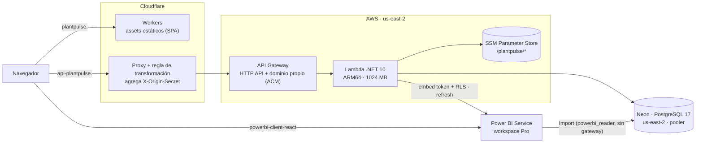

# PlantPulse — Despliegue en producción

Arquitectura serverless de bajo costo: sin servidores que administrar y con costo casi nulo cuando no hay tráfico.

- Portal: **https://plantpulse.edensoft.com.mx**
- API: **https://api-plantpulse.edensoft.com.mx** (`GET /api/health`)

## Arquitectura



| Pieza | Detalle |
|---|---|
| **Frontend** | `web/wrangler.jsonc`: Worker solo de assets, `not_found_handling = "single-page-application"` para las rutas de React Router y dominio propio. `VITE_API_URL` va en `web/.env.production`. `public/_headers`: caché inmutable para `/assets/*` y encabezados de seguridad. |
| **API** | `Amazon.Lambda.AspNetCoreServer.Hosting` (`AddAWSLambdaHosting(HttpApi)`): la misma app ASP.NET Core corre en Kestrel (local/Docker) o en Lambda. Plantilla SAM en `api/src/PlantPulse.Api/serverless.template` (función, HTTP API con *throttling*, logs con 14 días de retención, permiso `ssm:GetParametersByPath` solo sobre su prefijo). |
| **Secretos** | SSM Parameter Store (`SecureString`), cargados con `AddSystemsManager("/plantpulse")` solo dentro de Lambda: cadena de conexión, llave JWT, `OriginSecret`, token de Banxico y credenciales del *service principal* de Power BI. Nada de secretos en el repo ni en `appsettings`. |
| **Base de datos** | Neon (PostgreSQL 17 serverless) en la misma región que Lambda. La API usa el **pooler**; las migraciones y Power BI usan el host **directo**. Branches de Neon como respaldo antes de cada cambio. |
| **Zona horaria** | El runtime de Lambda no garantiza tzdata: `America/Mexico_City` va empaquetado en `zoneinfo/` y se usa con `TZDIR=/var/task/zoneinfo`. |

## Seguridad del origen

API Gateway tiene una URL pública (`*.execute-api.amazonaws.com`). Para que solo se llegue por Cloudflare:

1. Una **regla de transformación de encabezados de solicitud** en Cloudflare agrega `X-Origin-Secret` a todo lo que va a `api-plantpulse.edensoft.com.mx`.
2. `OriginSecretMiddleware` responde **403** si el header falta o no coincide (comparación en tiempo constante). En Lambda el secreto es obligatorio: si no está en SSM, la función no arranca.
3. El cliente HTTP del ERP simulado (que vive en la misma API) también envía el header.

Además: JWT con roles y acceso por planta, CORS limitado al dominio del portal, y Power BI lee con un rol de solo lectura sobre el esquema `bi`.

## Desplegar

**Migraciones primero.** Cada migración nueva se aplica en Neon **antes** de desplegar la API:
```powershell
# 1. Respaldo: branch de Neon a partir de production.
# 2. Cadena DIRECTA en una variable de la sesión (nunca en archivos ni en el historial).
dotnet ef migrations list   --project api\src\PlantPulse.Infrastructure --startup-project api\src\PlantPulse.Api
dotnet ef migrations script --idempotent --project api\src\PlantPulse.Infrastructure --startup-project api\src\PlantPulse.Api -o migraciones-REVISAR.sql
dotnet ef database update   --project api\src\PlantPulse.Infrastructure --startup-project api\src\PlantPulse.Api
```
Si una migración cambia columnas que usan las vistas `bi.*`, primero se eliminan las vistas y al final se vuelven a crear (ver [Power BI](power-bi.md)).

**API**
```powershell
aws login --profile <perfil>
cd api\src\PlantPulse.Api
dotnet lambda deploy-serverless --s3-bucket <bucket-de-despliegue>
```

**Frontend**
```powershell
cd web
npm ci; npm run build
npx wrangler@4 deploy
```

**Verificación**
```powershell
curl.exe -s https://api-plantpulse.edensoft.com.mx/api/health                                      # 200 Healthy
curl.exe -s -o NUL -w "%{http_code}" https://<api-id>.execute-api.us-east-2.amazonaws.com/api/health # 403 (sin Cloudflare)
```

## Lecciones aprendidas

- **Sin procesos en segundo plano en Lambda.** El refresh de Power BI se rediseñó con estado en la base (`powerbi_refresh_estado` + `FOR UPDATE`) en lugar de un `BackgroundService` con un canal en memoria.
- **Pruebas que dependen de secretos locales.** Una prueba pasaba en la máquina (user-secrets) y fallaba en la CI. Todas las pruebas de integración usan la misma `WebApplicationFactory` con configuración de prueba.
- **Neon y Power BI:** el servicio no envía SNI; el endpoint va en la contraseña (`endpoint=<id>$<contraseña>`).
- **Branches de Neon:** las branches hijas pueden nacer con fecha de expiración; para un respaldo hay que quitarla.
- **DNS:** el registro de validación del certificado (ACM) va sin proxy y se conserva para la renovación automática; el CNAME de la API va con proxy.
